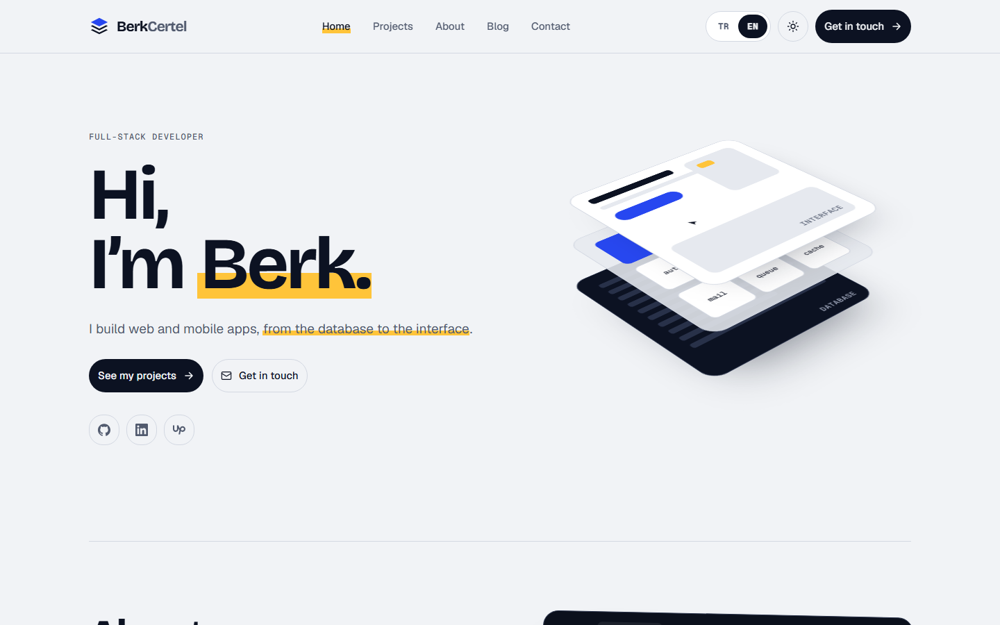

# berkcertel.com

Personal portfolio and blog of **Mehmet Berk Certel**, full-stack developer. Bilingual (Turkish and English), light and dark themes, built for speed, accessibility and search.

**Live:** [berkcertel.com](https://berkcertel.com)

<picture>
  <source media="(prefers-color-scheme: dark)" srcset=".github/assets/home-dark.png">
  
</picture>

## Features

- **Two languages:** Turkish at `/`, English at `/en`, with localized URLs (`/hakkimda` ↔ `/en/about`). The URL alone decides the language; the switch keeps you on the same page, including the translated blog post.
- **Light and dark theme:** follows the system setting, remembers a manual choice, no flash on load.
- **MDX blog:** posts in `content/blog/{tr,en}`, categories, table of contents, and scheduled publishing. Posts dated in the future stay hidden everywhere (list, home, sitemap, share images) and appear on their date (Europe/Istanbul) without a new deploy.
- **SEO:** per-page metadata, canonical URLs, `hreflang`, Open Graph and Twitter images generated per page and per post, JSON-LD (Person, WebSite, BlogPosting, BreadcrumbList, SoftwareSourceCode), sitemap, robots and web manifest.
- **Contact form:** validated with zod on the client and in a Server Action, protected by Cloudflare Turnstile and a honeypot, delivered by email over Gmail SMTP. No database.
- **Privacy:** KVKK privacy notice and cookie policy pages, a separate explicit-consent checkbox on the form, and no tracking or analytics cookies.
- **Accessibility:** semantic landmarks, one `h1` per page, keyboard-friendly menu, visible focus, reduced-motion support, automated axe checks.

## Tech stack

- [Next.js](https://nextjs.org) (App Router, Cache Components), React, TypeScript
- [Tailwind CSS](https://tailwindcss.com) v4 and [shadcn/ui](https://ui.shadcn.com)
- [next-intl](https://next-intl.dev) for routing and translations
- [MDX](https://mdxjs.com) via `@next/mdx`
- react-hook-form + zod, Nodemailer, Cloudflare Turnstile
- Vitest and Playwright (with axe-core), ESLint and Prettier
- [Bun](https://bun.sh) as package manager and script runner

## Project structure

```txt
content/blog/{tr,en}/   MDX blog posts
messages/{tr,en}.json   all interface copy
public/                 brand assets, icons, CV files
src/
  app/                  routes ([locale] pages), sitemap, robots, manifest, OG images
  actions/              Server Actions (contact form)
  components/           ui (shadcn), common, layout and page sections
  constants/            site data that is not copy (projects, socials, …)
  i18n/                 next-intl routing and navigation
  lib/                  env, SEO, JSON-LD, blog, mail, Turnstile helpers
  schemas/              zod schemas
tests/e2e/              Playwright tests
docs/                   design reference
```

The `docs/` folder is the design reference: the design spec, tokens, original mockups, screenshots and content notes.

## Getting started

Requirements: [Bun](https://bun.sh) 1.3 or newer.

```bash
bun install
cp .env.example .env.local   # then fill in the values
bun dev
```

The site runs at [http://localhost:3000](http://localhost:3000). Everything except sending the contact form works without any environment variables.

## Environment variables

See [`.env.example`](.env.example) for details. Variables are validated in `src/lib/env.ts` (public) and `src/lib/env.server.ts` (server only).

| Variable | Purpose | Required |
| --- | --- | --- |
| `SITE_URL` | Site URL for canonical links, sitemap and Open Graph | No (defaults to `https://berkcertel.com`) |
| `SMTP_HOST` | SMTP server | No (defaults to `smtp.gmail.com`) |
| `SMTP_PORT` | SMTP port | No (defaults to `465`) |
| `SMTP_SECURE` | Use SSL/TLS | No (defaults to `true`) |
| `SMTP_USER` | Gmail address that sends the contact mails | To send mail |
| `SMTP_PASS` | Google App password for `SMTP_USER` | To send mail |
| `CONTACT_TO_EMAIL` | Inbox that receives contact messages | To send mail |
| `NEXT_PUBLIC_TURNSTILE_SITE_KEY` | Turnstile widget site key | To send mail |
| `TURNSTILE_SECRET_KEY` | Turnstile server-side secret | To send mail |
| `NEXT_PUBLIC_GOOGLE_SITE_VERIFICATION` | Google Search Console verification | No |

## Scripts

| Script | What it does |
| --- | --- |
| `bun dev` | Development server |
| `bun run build` | Production build |
| `bun run start` | Serve the production build |
| `bun run lint` | ESLint |
| `bun run typecheck` | TypeScript (`tsc --noEmit`) |
| `bun run test` | Unit tests (Vitest) |
| `bun run test:e2e` | End-to-end and accessibility tests (Playwright; builds and serves on port 3100) |
| `bun run format` | Format with Prettier |

CI (GitHub Actions) runs lint, typecheck, unit tests and the build on every push and pull request.

## Deployment

The site is built for [Vercel](https://vercel.com). Import the repository, add the environment variables from the table above in the project settings (Production), and deploy. No extra build settings are needed.

## License

© Mehmet Berk Certel. All rights reserved.
